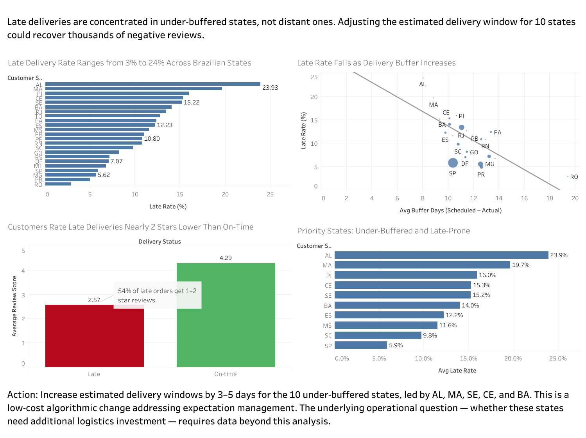

# Olist Marketplace: Delivery Buffer and Customer Satisfaction Analysis by Tessa

## 1. Business Context

Olist is a Brazilian e-commerce marketplace connecting small sellers to major platforms. Of the ~96,000 delivered orders in this dataset, 8.11% arrive after the estimated delivery date. This analysis investigates where late deliveries concentrate and what they cost in customer satisfaction.

## 2. Data

- **Source:** Olist Brazilian E-Commerce Public Dataset (Kaggle)
- **Size:** 99,441 orders across 9 relational tables
- **Structure note:** Order-level analysis; multi-table joins across orders, customers, order_items, and order_reviews.
- **Metric:** late = `order_delivered_customer_date > order_estimated_delivery_date`

Raw data available at [Kaggle](https://www.kaggle.com/datasets/olistbr/brazilian-ecommerce). Run `python load_olist_data.py` and `python export_for_tableau.py` to rebuild the database and Tableau exports.

## 3. Approach

SQL-based diagnostic in five phases:

1. Baseline — overall late rate
2. Geographic concentration — late rate by customer state
3. Mechanism — buffer vs distance
4. Business impact — review score comparison
5. Prioritization — under-buffered states ranked by late rate

## 4. Findings

- **8.11% of delivered orders are late** across 96,476 evaluable orders.
- **Geographic concentration:** late rates range from 2.88% (RO) to 23.93% (AL) — an 8x spread. The worst five states (AL, MA, PI, CE, SE) are all in Northeast Brazil.
- **Mechanism:** the driver is not distance — it's the estimated-delivery buffer. Under-buffered states (<11 days buffer) show 15–24% late rates even when geographically closer than well-buffered states.
- **Business impact:** late orders average **2.57 stars** vs **4.29** for on-time. **54% of late orders receive 1–2 star reviews**, vs 9% for on-time.
- **Universality:** the late→low-review pattern holds in every state (late scores 1.94–3.20; on-time scores 4.15–4.40).

## 5. Recommendation

Two distinct issues emerged:

1. **Expectation management (actionable now):** Increase estimated delivery windows by 3–5 days for the 10 under-buffered states, led by AL, MA, SE, CE, and BA. Low-cost algorithmic change; expected to reduce late rates to national average and recover ~3,450 excess low reviews.

2. **Operational performance (requires further investigation):** Customers in under-buffered states also wait 20+ days on average for delivery, vs 7–10 days in São Paulo. Whether this reflects under-investment in regional logistics cannot be determined from this dataset. Additional data (carrier costs, alternative fulfillment locations) would be required.

## 6. Limitations

- Olist's estimated delivery dates are algorithmic, so "late" is defined relative to Olist's own estimates, not customer expectations.
- 2,965 orders (3.0%) had no delivery date and were excluded from late-rate calculations.
- States with fewer than 200 delivered orders were excluded to avoid small-sample noise (23 of 27 states retained).
- Sales/freight figures reflect item totals and do not include platform fees.

## 7. Tools

- **SQL** (SQLite via Database Client in VS Code) — diagnostic queries, joins, date math
- **Python** (pandas) — multi-table CSV loading, Tableau exports
- **Tableau Public** — interactive dashboard ([live link](https://bit.ly/4yIroXx))
